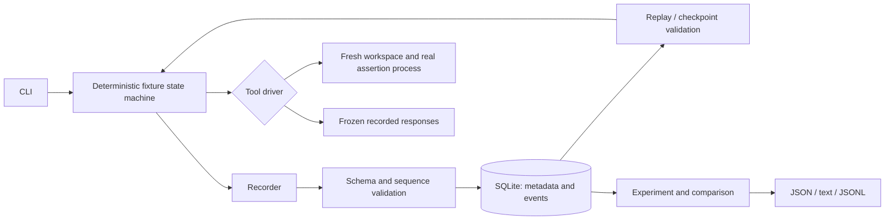

# Architecture

CAUSAL is a single-process TypeScript workspace with an embedded SQLite database. The only child process is the trusted fixture assertion runner. The CLI has no server or UI dependency.

## Flow

## Boundaries

`trace-schema` owns the wire format, canonical JSON, snapshot integrity, normalization and generic history invariants. It knows nothing about SQLite, subprocesses, or agent control flow. Event IDs can later map to tracing span IDs; event parent links and tool call IDs already preserve topology and correlation. Version 1 does not claim OpenTelemetry compliance.

`recorder` assigns zero-based contiguous sequence numbers and trace-local event IDs. A clock is injectable; timestamps are descriptive metadata. `Recorder.events()` returns a deep copy. `TraceStore` separates recording from persistence. `SqliteTraceStore` commits a complete validated trace in one transaction, uses parameterized statements, and rejects duplicate trace IDs. On load it validates events and checks the complete-history SHA-256 digest.

The example package owns the agent and tools. Its state machine consumes a documentation observation, chooses an API, renders a trusted source template, writes it, and asks the assertion tool to execute it. The tool result is independently mirrored as a `test.completed` event. Failed assertions produce `run.completed` with `success: false`; operational tool errors produce a structured errored `tool.completed` and a terminal `run.failed`, then propagate to the caller. Storage errors remain operational failures.

The live driver creates a unique temporary directory, verifies the checkpoint, restores trusted files, and hashes restored bytes. It permits only the known documentation request, `solution.mjs` write using one of two exact source templates, and the fixed authentication test. The source write result hashes the file read back from disk. Child processes never receive the host environment or user-supplied command arguments. Workspaces are removed in `finally` even when a run fails.

`replay-engine` runs that same state machine against a response tape and compares canonical normalized events. A fork validates the parent's replay, checks the target and checkpoint, then creates a live driver with a replacement documentation observation. It does not import arbitrary snapshot files or execute source from a trace.

`experiment-engine` validates both histories through replay, checks the child's reference against the parent observation and common checkpoint, and compares test results, code, agent decisions and final state. Experiments accept a named success predicate and 1–100 trials. Each trial has a distinct trace ID and real live continuation. No confidence interval is manufactured for repeated deterministic outcomes.

## Critical invariants

1. One trace ID, unique event IDs, contiguous zero-based sequence numbers, and one starting event per history.
2. Every tool result correlates with an earlier unmatched call of the same identity; its parent is that call. Call IDs cannot be reused. No event follows a terminal event.
3. A normal completion has no pending calls. Operational failures may stop with pending work. A fork contains exactly one intervention matching its start-event lineage.
4. A checkpoint's fingerprint equals canonical SHA-256 of its body. Paths are constrained. A live continuation additionally requires byte-for-byte equality with the supported trusted boundary.
5. A fork receives a new trace ID and a separate workspace. Initial fixture states match; downstream decisions are freshly computed.
6. Expected assertion failure is distinct from inability to execute/capture a test. The runner requires both an allowed exit status and a test-result marker.
7. Wall-clock times, absolute temporary paths and random identifiers never affect decisions. Absolute workspace paths are not part of the portable history.
8. No imported data is executable. Only the fixture's compiled-in library, runner and validated templates can reach the process runner.

## Persistence and artifacts

SQLite stores one metadata row (`id`, `parent_id`, `outcome`, `digest`) per trace and ordered JSON event rows keyed by `(trace_id, sequence)`, with unique event IDs within each trace. Parent IDs intentionally need not be present in the database, allowing independent portable imports. Comparison requires both histories and verifies their relationship.

Snapshots and generated source are small and inline in version 1. Fingerprints are content addresses; an external blob store is deferred until artifact sizes justify it. JSONL exports retain full events and embedded state. JSON/text reports include the evidence needed to follow the experimental contrast. They are written with exclusive creation to prevent accidental overwrites.

The database is local, synchronous and single-user oriented. WAL improves concurrent readers; trace insertion uses a transaction. There is no migration framework yet: schema and fixture changes require explicit version handling rather than silently accepting old semantics.
